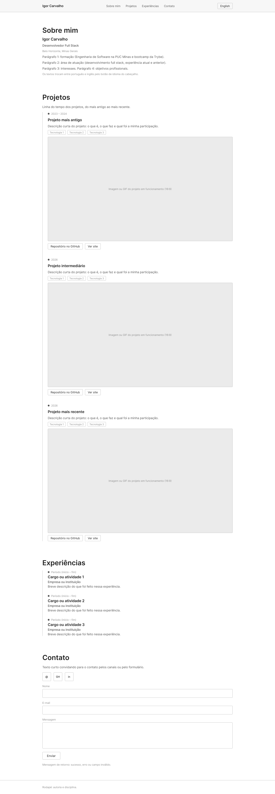
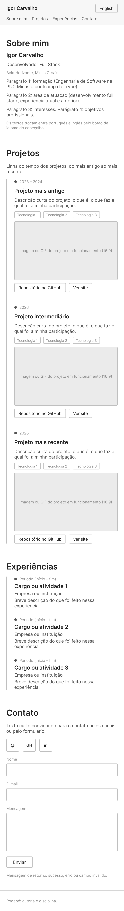
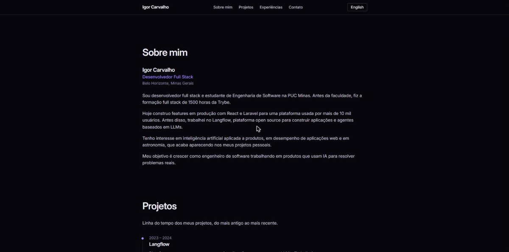

# Portfólio Profissional · Igor Carvalho

> [!NOTE]
> Página única com a apresentação profissional de Igor Carvalho, desenvolvedor full stack. Mostra quem ele é, os projetos já feitos, a experiência profissional e um formulário de contato que envia mensagens por e-mail.

Trabalho Prático 1 da disciplina **Desenvolvimento e Integração de Aplicações Web**, curso de Engenharia de Software da PUC Minas, semestre 2026/2.

---

## Índice
- [Links Úteis](#links-úteis)
- [Sobre o Projeto](#sobre-o-projeto)
- [Funcionalidades Principais](#funcionalidades-principais)
- [Tecnologias Utilizadas](#tecnologias-utilizadas)
  - [Dependências e bibliotecas](#dependências-e-bibliotecas)
- [Arquitetura](#arquitetura)
- [Instalação e Execução](#instalação-e-execução)
  - [Pré-requisitos](#pré-requisitos)
  - [Variáveis de Ambiente](#variáveis-de-ambiente)
  - [Instalação de Dependências](#instalação-de-dependências)
  - [Como Executar a Aplicação](#como-executar-a-aplicação)
- [Deploy](#deploy)
- [Estrutura de Pastas](#estrutura-de-pastas)
- [Wireframes](#wireframes)
- [Demonstração](#demonstração)
- [Documentações utilizadas](#documentações-utilizadas)
- [Autor](#autor)

---

## Links Úteis
* **Site publicado:** [diaw-portfolio.vercel.app](https://diaw-portfolio.vercel.app)
  > **Descrição:** Versão em produção do portfólio, hospedada na Vercel.
* **Repositório:** [github.com/igorrCarvalho/diaw-portfolio](https://github.com/igorrCarvalho/diaw-portfolio)
  > **Descrição:** Código-fonte deste projeto no GitHub.

---

## Sobre o Projeto
O site é o portfólio profissional de Igor Carvalho e foi feito como Trabalho Prático 1 da disciplina de Desenvolvimento e Integração de Aplicações Web. O objetivo é apresentar o perfil profissional em uma página só, com linguagem clara, projetos reais e um canal de contato direto.

O conteúdo fica separado da interface. Todos os textos estão em arquivos JSON, um para português e outro para inglês, o que facilita alterar o que é mostrado sem mexer nos componentes.

> [!NOTE]
> A página não tem back-end próprio. O formulário de contato envia os dados diretamente do navegador para a API do Web3Forms, que encaminha a mensagem por e-mail.

---

## Funcionalidades Principais
Página única com menu de navegação fixo no topo e quatro seções:

- **Sobre mim:** apresentação em português ou inglês. O botão de idioma no cabeçalho troca todos os textos do site.
- **Projetos:** linha do tempo do mais antigo ao mais recente. Cada projeto tem nome, período, descrição, tecnologias, link para o GitHub (quando público), link para o site (quando existe) e imagem.
- **Experiências:** formação e experiências profissionais em ordem cronológica.
- **Contato:** ícones clicáveis para e-mail, GitHub e LinkedIn, e um formulário com nome, e-mail e mensagem. O formulário valida os campos antes de enviar e mostra o resultado do envio.

---

## Tecnologias Utilizadas

As versões abaixo são as indicadas no `package.json`.

### Front-end
- **React 19:** biblioteca para construir a interface com componentes.
- **Vite:** servidor de desenvolvimento e ferramenta de build.
- **Tailwind CSS v4:** framework de CSS utilitário, integrado ao Vite pelo plugin `@tailwindcss/vite`.
- **JavaScript (JSX):** linguagem usada em todo o projeto, sem TypeScript.
- **ESLint 9:** análise estática do código.

### Infraestrutura & DevOps
- **Vercel (plano gratuito):** hospedagem do site publicado.
- **GitHub:** versionamento do código.

### Dependências e bibliotecas

| Pacote | Versão (`package.json`) | Para que serve |
|--------|-------------------------|----------------|
| `react` | ^19.3.1 | Criação dos componentes da interface |
| `react-dom` | ^19.3.1 | Renderização dos componentes no navegador |
| `vite` | ^8.3.8 | Servidor de desenvolvimento, preview e build de produção |
| `@vitejs/plugin-react` | ^6.3.0 | Suporte a React no Vite (JSX e atualização rápida no desenvolvimento) |
| `tailwindcss` | ^4.3.5 | Estilos utilitários e tema de cores e fontes |
| `@tailwindcss/vite` | ^4.3.5 | Integração do Tailwind CSS v4 ao Vite |
| `eslint` | ^9.39.5 | Verificação de código com `npm run lint` |
| `@eslint/js` | ^9.39.5 | Regras recomendadas de JavaScript para o ESLint |
| `eslint-plugin-react` | ^7.37.5 | Regras específicas para React e JSX |
| `eslint-plugin-react-hooks` | ^7.1.1 | Verificação do uso correto dos hooks |
| `globals` | ^17.14.0 | Lista de variáveis globais do navegador e do Node.js para o ESLint |

---

## Arquitetura

O projeto é uma aplicação React de página única, sem back-end.

- **Estado e conteúdo:** o componente `App.jsx` guarda o idioma atual em estado (`pt` ou `en`). A partir dele escolhe o arquivo de conteúdo correspondente e passa para cada seção apenas o trecho de que ela precisa, como `about`, `projects`, `experience` e `contact`.
- **Textos:** ficam em `src/content/pt.json` e `src/content/en.json`. Os componentes não têm texto fixo, exceto por elementos de interface que dependem do código.
- **Componentes:** cada seção da página é um componente em `src/components`. Componentes menores, como `SectionTitle`, `Icon` e `ContactForm`, são reaproveitados ou isolados por responsabilidade.
- **Navegação:** as seções são âncoras (`#sobre`, `#projetos`, `#experiencias` e `#contato`). O cabeçalho fixo tem links para elas, e a rolagem é suave.
- **Formulário:** o `ContactForm` valida os campos no próprio navegador e envia a mensagem para a API do Web3Forms com a chave `VITE_WEB3FORMS_KEY`.

---

## Instalação e Execução

### Pré-requisitos
* **Node.js:** versão 22 ou superior
* **Gerenciador de pacotes:** npm (vem com o Node.js)
* **Git:** para clonar o repositório

---

### Variáveis de Ambiente

O formulário de contato usa uma chave de acesso do Web3Forms. Para obter a sua, acesse [web3forms.com](https://web3forms.com) e informe o e-mail que vai receber as mensagens.

1. Copie o arquivo de exemplo:

```bash
cp .env.example .env
```

2. Abra o `.env` e preencha a variável:

```env
VITE_WEB3FORMS_KEY=sua-chave-de-acesso
```

O arquivo `.env` não vai para o repositório, porque está no `.gitignore`. Sem essa variável, o formulário mostra uma mensagem de erro ao ser enviado. O restante do site funciona normalmente.

---

### Instalação de Dependências

1. **Clone o repositório:**

```bash
git clone https://github.com/igorrCarvalho/diaw-portfolio.git
cd diaw-portfolio
```

2. **Instale as dependências:**

```bash
npm install
```

---

### Como Executar a Aplicação

| Comando | O que faz |
|---------|-----------|
| `npm run dev` | Inicia o servidor de desenvolvimento, normalmente em `http://localhost:5173` |
| `npm run build` | Gera a versão de produção na pasta `dist/` |
| `npm run preview` | Serve localmente a versão gerada pelo build, normalmente em `http://localhost:4173` |
| `npm run lint` | Verifica o código com o ESLint |

---

## Deploy

O site está publicado na Vercel, no plano gratuito, em [diaw-portfolio.vercel.app](https://diaw-portfolio.vercel.app).

Para publicar uma cópia do projeto:

1. Acesse a [Vercel](https://vercel.com) e clique em **Add New > Project**.
2. Importe o repositório do GitHub.
3. Em **Framework Preset**, selecione **Vite**. O comando de build (`npm run build`) e a pasta de saída (`dist`) são preenchidos automaticamente.
4. Em **Environment Variables**, adicione `VITE_WEB3FORMS_KEY` com a sua chave de acesso.
5. Clique em **Deploy**.

> [!IMPORTANT]
> As variáveis que começam com `VITE_` são gravadas no código durante o build. Se a chave for alterada depois do deploy, é preciso fazer um novo deploy para que a mudança tenha efeito.

---

## Estrutura de Pastas

```
.
├── .env.example                 # Modelo da variável de ambiente do formulário.
├── .gitignore                   # Arquivos que não vão para o repositório (.env, node_modules, dist).
├── README.md                    # Documentação do projeto.
├── eslint.config.js             # Configuração do ESLint.
├── index.html                   # Página HTML que carrega a aplicação React.
├── package.json                 # Scripts e dependências do projeto.
├── package-lock.json            # Versões exatas das dependências instaladas.
├── vite.config.js               # Configuração do Vite com os plugins React e Tailwind.
│
├── docs/
│   └── wireframes/              # Wireframes das versões desktop e celular.
│
├── public/                      # Arquivos servidos como estão.
│   ├── favicon-16.png           # Ícone da aba (16px).
│   ├── favicon-32.png           # Ícone da aba (32px).
│   ├── fonts/
│   │   └── inter-latin.woff2    # Fonte Inter, usada no site.
│   └── projects/                # Imagens dos projetos na seção Projetos.
│
└── src/                         # Código-fonte da aplicação.
    ├── main.jsx                 # Ponto de entrada que monta o React na página.
    ├── App.jsx                  # Componente principal: idioma, cabeçalho e seções.
    ├── index.css                # Estilos globais, fonte e cores do tema.
    ├── components/              # Componentes de cada seção e elementos da interface.
    │   ├── About.jsx            # Seção Sobre mim.
    │   ├── Projects.jsx         # Seção Projetos (linha do tempo).
    │   ├── Experience.jsx       # Seção Experiências.
    │   ├── Contact.jsx          # Seção Contato, com ícones e formulário.
    │   ├── ContactForm.jsx      # Formulário de contato e envio pelo Web3Forms.
    │   ├── Header.jsx           # Cabeçalho fixo com menu e botão de idioma.
    │   ├── Footer.jsx           # Rodapé.
    │   ├── Icon.jsx             # Ícones de e-mail, GitHub e LinkedIn.
    │   └── SectionTitle.jsx     # Título padrão das seções.
    └── content/                 # Textos do site.
        ├── pt.json              # Conteúdo em português.
        └── en.json              # Conteúdo em inglês.
```

---

## Wireframes

Wireframes de média fidelidade feitos no Figma, nas versões desktop (1280 px) e celular (390 px).

<p>
  
  
</p>

---

## Demonstração

Visão geral da página inicial publicada:



---

## Documentações utilizadas

* **Biblioteca (Front-end):** [Documentação oficial do **React**](https://react.dev/reference/react)
* **Build Tool:** [Guia de configuração do **Vite**](https://vite.dev/config/)
* **Estilos:** [Documentação do **Tailwind CSS**](https://tailwindcss.com/docs)
* **Formulário:** [Documentação da API do **Web3Forms**](https://web3forms.com/)
* **Hospedagem:** [Documentação da **Vercel**](https://vercel.com/docs)

---

## Autor
* **Nome:** Igor Costa Carvalho Campos Silva
* **GitHub:** [igorrCarvalho](https://github.com/igorrCarvalho)
* **LinkedIn:** [dev-igor-carvalho](https://linkedin.com/in/dev-igor-carvalho)
